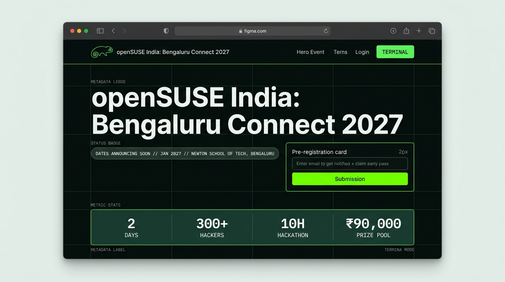
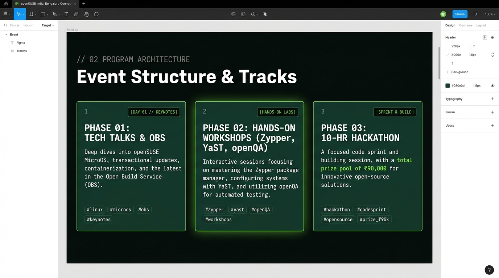

# openSUSE India – Bengaluru Connect 2027

> **Explore Open Source. Learn openSUSE. Build Together.**

Official repository and website for **openSUSE India – Bengaluru Connect 2027**, a two-day community-driven open-source technology conference, hands-on workshop series, and 10-hour hackathon.

---

## 🎨 Design Mockups (Minimalism + Neo-Brutalism)

The website design combines **minimalism** and **neo-brutalism** with canonical openSUSE branding: high-contrast obsidian dark backgrounds (`#090e0d`), openSUSE deep pine green (`#173f35`), sharp borders, monospaced terminal telemetry, and high-voltage openSUSE Geeko green accents (`#73ba25`).

### 1. Hero Section & Pre-Registration View


### 2. 3-Phase Structure & Hackathon Tracks View


---

## 📌 Event Details

- **Event Type:** Open-Source Community Meetup, Technical Workshops & Hackathon
- **Proposed Dates:** January 2027 *(Exact Dates to Be Confirmed)*
- **Duration:** 2 Days
- **Location:** Bengaluru, Karnataka, India
- **Proposed Venue:** Newton School of Technology, Bengaluru
- **Expected Participation:** 300–400 Participants
- **Organized by:** openSUSE India Community
- **Admission:** 100% Free & Open-Source Community Event

---

## ⚡ Key Website Features

1. **Interactive Proposal & Linux Boot Sequence (`proposal/`):**
   - Built on the concept of **Synergy'26** with an authentic openSUSE GRUB v2.06 & Linux kernel systemd bootloader.
   - Zero stock image bloat; high-concept retro-modern arcade aesthetic (`#06030f`), scanlines, phosphor glow, and synthesized 8-bit Web Audio SFX.
   - Comprehensive interactive breakdown of the revised 18-page proposal:
     - **01. Executive HUD & Approval Status** (Decision-ready plan, goals & measures).
     - **02. Six Geeko Buildathon Tracks** (Terminal Titans, Root Access, GeekoOps, Desktop Reboot, Upstream Heroes, What Does Linux Need Next?).
     - **03. 20-Hour Operational Agenda** (Day 1 14:30 to Day 2 10:30 non-stop clock).
     - **04. Geeko Arcade, Quest & Midnight Bug Hunt** (Playable Terminal Escape mini-game, Trivia Blitz, QR digital passport, Rookie/Expert bug hunt).
     - **05. Demo Arena & Judging Rubrics** (Interactive 5-factor weighted scoring calculator, ₹50,000 top-3 prize pool, trophies & 25 reward T-shirts).
     - **06. Itemized Budget & Sponsorship Gap** (₹1,20,400 catering + ₹64,000 operations + ₹50,000 cash prizes + 10% reserve = ₹2,57,840 total envelope; interactive live gap simulator).
     - **07. Venue Operations & Safety Gates** (Newton School of Technology specs, 350+ Wi-Fi devices, 30-person roster, Go/No-Go Gates T-21 & T-7).
     - **08. Operational Timeline & Formal Sign-off** (Milestones from Nov 2026 to T+30, print/PDF export, funding.json integration).
   - Accessible at `/opensuse-event-blr/proposal/` and via the "⚡ PROPOSAL & BOOT" navigation button.

2. **Pre-Registration & Dynamic Digital Pass Generator:**
   - Dedicated pre-registration system for participants to reserve priority entry before exact January 2027 dates are locked.
   - Generates a personalized **Neo-Brutalist Digital Ticket / Pass** with unique ID (`OSBLR-2027-XXXX`), attendee info, barcode telemetry, and instant sharing to X/Twitter or clipboard.
   - Built to easily switch to `datesConfirmed: true` once final dates are finalized without layout shifts.

2. **Interactive Zypper Terminal CLI:**
   - In-browser interactive openSUSE terminal simulator.
   - Try commands like `zypper in opensuse-blr`, `zypper info event`, `zypper lr`, `geeko`, `yast`, `obs`, and `help`.

3. **3-Phase Detailed Syllabus:**
   - **Phase 01:** Technical Talks & Community Engagement (Leap vs Tumbleweed, Linux careers, OBS introduction, openSUSE governance).
   - **Phase 02:** Hands-on Technical Workshops (YaST system control, Zypper package management, OBS binary packaging, openQA automated operating system tests, Git workflows).
   - **Phase 03:** 10-Hour Open-Source Hackathon (5 targeted tracks, on-site openSUSE maintainer mentorship, prototype evaluations, awards).

4. **10-Hour Hackathon Tracks:**
   - Track 01: Linux & Developer Productivity Tools
   - Track 02: Open-Source Automation & System Utilities
   - Track 03: Cloud-Native & Infrastructure Technologies
   - Track 04: Open-Source Applications & Community Solutions
   - Track 05: openSUSE Ecosystem Integrations

5. **Financial Transparency & Sponsorship Deck:**
   - Complete breakdown of the **₹90,000 INR** community budget pool.
   - Call for community sponsors, partners, and student travel benefactors.

6. **Road to openSUSE Conf India:**
   - Clear community roadmap explaining how Bengaluru Connect 2027 acts as the nationwide launchpad.

---

## 👥 Organizing Committee

- **Divyanshu Prakash** — Lead Organizer
- **Dushyant Acharya** — Co-Organizer & Technical Coordinator
- **Rithull Raj Kallat** — Co-Organizer & Operations Lead

---

## 🚀 Getting Started Locally

### Prerequisites
- Node.js (v18+ or v20+)
- npm or yarn

### Installation & Run

```bash
# Clone the repository
git clone https://github.com/divyanshuprakas-h/opensuse-event-blr.git
cd opensuse-event-blr

# Install dependencies
npm install

# Start local development server
npm run dev
```

Visit `http://localhost:5173` to explore the website.

### Production Build

```bash
npm run build
```

The production output is bundled into `dist/`.

---

## 🌐 Automatic GitHub Pages Deployment

This repository includes a GitHub Actions workflow (`.github/workflows/deploy.yml`) that automatically builds and publishes the website to GitHub Pages upon pushing to `main`.

To enable GitHub Pages in your GitHub repository:
1. Go to repository **Settings** → **Pages**
2. Under **Build and deployment** → **Source**, select **GitHub Actions**
3. Any push to `main` will automatically build and publish the live site!

---

*openSUSE India Community • Have a lot of fun…*
